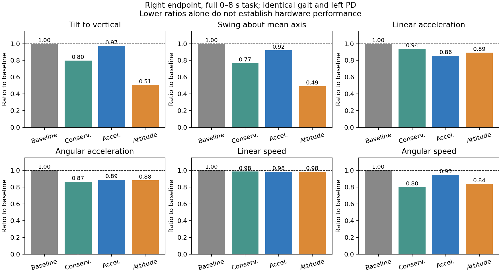

# 2026-10-10 MPC 综合优化：纯仿真研究

本次从已保存的原仿真基线重新复现，进行了 **411 次新仿真尝试，398 次完整结束，完整运行覆盖 331 种不同配置**，并按中间结果改变探索方向。完整结束不代表通过全部筛选：求解回退等失败也保留。最终保留三组综合候选：**保守范围、加速度综合、姿态综合**。它们在标准任务的六项右端指标均优于原右端，且两项倾角指标明显优于同轮左端。加速度综合方案从 **2.9415 降到 2.5214 m/s²（降低 14.28%）**，不是机器人的物理极限。

**没有实现右端三维加速度显著低于左端。** 该方案同轮左端为 2.3550 m/s²，右端仍高约 7.1%。原基线左右为 2.2992 / 2.9415 m/s²。所有左臂 PD 参数、中立位、负载、行走命令均保持不变；不同右臂控制会通过全身耦合略微改变左臂运动，故保留每一轮自己的左臂数据。

本研究没有连接机器人或发送控制指令；原真机成功基线、原仿真默认配置没有覆盖。这里的 YAML 是**仿真配置**，不能直接传给真机入口。

## 结果与定义

统一窗口为任务时间 **0 ≤ t < 8 s**，包含起步、行走和 6.4 s 后的停车，物理步长 2 ms。完整左右对比和六项改善百分比见 [METRICS.md](METRICS.md)，全部运行包括失败见 [all_results.csv](all_results.csv)，精确计数见 [summary.json](summary.json)。旧的 55 组不计入本轮数量。

主表沿用旧 55 组的 200 mm、250 g 仿真负载，以便与原 2.9415 m/s² 严格比较；75 mm、250 g 当前负载另做同模型基线和候选对照。在 75 mm 模型中，原右端为 2.953 m/s²，加速度综合方案为 2.527 m/s²，改善趋势保留。

| 右端方案 | 竖直倾角均值 ° | 相对平均轴摆动 RMS ° | 线加速度 RMS m/s² | 角加速度 RMS rad/s² | 线速度 RMS m/s | 角速度 RMS rad/s |
| --- | --- | --- | --- | --- | --- | --- |
| 原仿真基线 | 0.1247 | 0.1500 | 2.9415 | 7.0451 | 0.4636 | 0.05958 |
| 保守范围 | 0.0995 | 0.1151 | 2.7618 | 6.0969 | 0.4565 | 0.04758 |
| 加速度综合 | 0.1212 | 0.1381 | 2.5214 | 6.2542 | 0.4563 | 0.05634 |
| 姿态综合 | 0.0632 | 0.0742 | 2.6284 | 6.2031 | 0.4563 | 0.04995 |

- 每帧瓶轴为末端旋转矩阵的 z 列 `z_i`。竖直倾角均值是 `mean(acos(z_i·e_z))`，无符号几何角。
- 平均方向为 `z_bar = sum(z_i)/norm(sum(z_i))`；摆动为 `sqrt(mean(acos(z_i·z_bar)^2))`。它不是倾角标量的标准差，也不评价绕瓶轴自转。
- 线／角加速度和线／角速度均用 **三维向量范数 RMS**：`sqrt(mean(sum(v_i**2)))`。世界系线加速度由原仿真 2 ms 末端速度差分记录，不包含重力比力，不另加平滑滤波；第一帧沿用原记录的零加速度。
- 速度是世界系速度。行走本来需要约 0.5 m/s，不能把“完全不动”当成最优。额外检查指令速度误差 RMS、行走距离及停车。原距离 3.2227 m，三候选 3.2036 / 3.2131 / 3.2052 m，变化均不足 0.6%；不是靠减慢腿部命令取得收益。
- 指令速度误差 RMS 从原 0.1879 m/s 降到约 0.1780 / 0.1756 / 0.1773 m/s。细项以保存的原始 JSON 为准。



## 最终参数与推荐顺序

统一使用 6 ms MPC、9 个预测区间（10 个状态节点，共 54 ms），全身 MuJoCo 接触与执行检查不变，物理执行器力矩上限保持模型中的 ±25 Nm。左臂和右臂底层 PD 均不改动。

| 设置 | 原基线 | 保守范围 | 加速度综合 | 姿态综合 |
| --- | --- | --- | --- | --- |
| q_ee_acc | 0.01 | 0.06 | 0.10 | 0.10 |
| q_ee_alpha | 0.0005 | 0.005 | 0.003 | 0.003 |
| q_ee_omega | 8 | 32 | 32 | 32 |
| q_gravity（每轴） | 30 | 300 | 100 | 1000 |
| q_posture | [4,4,1.5,0.2,0.2] | 原值 | 原值 ×3 | 原值 ×3 |
| 期望关节加速度上限 rad/s² | 8 | 15 | 25 | 25 |
| 关节速度上限 rad/s | 1 | 2 | 2 | 2 |
| 姿态预测误差校正 gain / decay | 关闭 | 1 / 0.15 s | 1 / 1 s | 1 / 1 s |
| 区间线／角加速度前视 | 0 | 3 ms | 3 ms | 3 ms |
| OSQP eps_abs / eps_rel | 1e-3 | 1e-4 | 1e-5 | 1e-5 |
| OSQP max_iter / polishing | 400 / false | 1500 / true | 4000 / false | 4000 / false |

各方案 `q_ee_vel=0`，其余设置均明确写入独立完整 YAML，不依赖运行时手工叠加。

1. **优先向真机迁移保守范围方案的思路。** 线加速度降低 6.11%，角加速度降低 13.46%，角速度降低 20.15%，两项倾角降低 20.22% / 23.30%。期望加速度 15 rad/s²，角度盒及裕量与当前真机操作范围对应；肩 pitch 实测峰值约 11.44°，更容易保持边界余量。
2. **加速度综合方案作为下一档探索。** 六项均改善，线加速度收益最大（14.28%）。需要允许更大肩／肘补偿；标准任务肩 pitch 最大绝对角约 15.42°，已经超过当前真机 ±20° 减去 5° 裕量后的 ±15° 操作盒，且期望加速度升到 25。不能原样装入当前真机门槛后宣称已验证。
3. **姿态综合方案用于兼顾姿态展示。** 两项倾角约减半，线加速度仍降低 10.64%，角速度降低 16.16%。肩 pitch 峰值约 17.55°，同样需要针对真机边界重新验证。

各关节实际力矩峰值、速度、角度及接触复核见 [LIMITS.md](LIMITS.md)。标准任务的三候选力矩峰值都在当前真机更保守的 `[10,6,4,7,1.5] Nm` 包络内；这只是仿真记录，不能代替真机安全验证。物理额定值依据仓库 G1 23DoF 模型及 [Unitree 官方 URDF](https://github.com/unitreerobotics/unitree_ros/blob/master/robots/g1_description/g1_23dof.urdf) 的关节 effort 限制解释，不把峰值当连续热负荷许可。

## 为什么有效：控制目标与预测偏差要同时处理

仅改变加速度权重并不保证真实闭环加速度下降。MPC 优化的是局部模型、预测扰动下的多项目标；姿态约束、关节运动余量、实际力矩执行、全身接触都会影响最终结果。

本轮有价值的算法改动是**因果的姿态预测误差校正**。在时刻 t，将当前实测身体旋转与上一拍未校正的一步预测比较：

`E(t) = R_measured(t) @ R_raw(t | t-dt).T`

未来旋转左乘 `Exp(gain * exp(-time_ahead/tau) * Log(E))`。只使用当前和过去数据，不读取未来仿真真值；保存的是未校正的预测，避免校正量递归抵消。当前状态节点不改，角速度预测不改，控制区间外的 terminal hold 不改。旋转与角速度预测仍不是严格动力学一致的联合估计，这也是后续迁移时需要保留的局限。

区间前视则只在现有预测范围内插值未来**线／角加速度区间均值**，最后区间保持；不移动实测状态或逆动力学输入。仿真选出的 3 ms 是此模板下的经验设置，不能当成真机已测得的固定延迟。

以加速度综合方案做独立消融，其他代价、运行边界和执行设置一致：

| 预测处理 | 倾角均值 ° | 平均轴摆动 RMS ° | 线加速度 m/s² | 角加速度 rad/s² |
| --- | --- | --- | --- | --- |
| 仅新代价／运行边界，不校正、不前视 | 0.3808 | 0.4801 | 2.5775 | 6.5043 |
| 只校正姿态 | 0.1192 | 0.1359 | 2.5854 | 6.5581 |
| 只前视 3 ms | 0.3805 | 0.4884 | 2.5245 | 6.2515 |
| 姿态校正 + 前视 3 ms | 0.1212 | 0.1381 | 2.5214 | 6.2542 |

可见：大部分加速度收益来自目标／运行余量调整；姿态校正主要收回倾角损失；前视再提供有限的动态收益。不能把总计 14.28% 全部归功于时间前视。

## 自适应探索与淘汰依据

实验顺序及理由见 [DECISIONS.md](DECISIONS.md)，具体每组输入见 [cases.json](cases.json)。主要探索包括：

- 加速度、角加速度、角速度、端平、关节回中、关节速度、输入及终端代价的组合；适当拓宽运行范围；实际接触和物理力矩限制全程保留。
- 前视时间正负偏移、实测线／角扰动创新、姿态预测创新及衰减；没有重新训练模板，也没有使用评估轨迹的未来数据。
- 3 / 6 / 8 个区间的缩短 QP、首个加速度输入变化代价、力矩映射正则／调用节奏、摩擦与右臂 PD 阻抗；只有可复核的有效方法进入正式预测器。
- 单纯放松姿态／放松肩肘回中、缩短预测窗口、输入平滑和直接加速度创新，没有形成优于最终三方案的稳定综合结果。
- 较低右臂 PD 刚度曾取得约 2.477 m/s²，但另一初态出现 1～6 次 QP 回退，4 ms 延迟也出现回退，故不晋升。真机现有增益本来就更低，不能把仿真降刚度收益当成真机新增收益。
- 更激进方案低至约 2.43 m/s²，但有多次求解回退；不因数据好看就放宽解的接受标准。

保留失败记录。初始样本、失败中止、导出异常及时间戳校验错误造成的中止，都不计为成功完成的实验。修正了原延迟实验在接近 8 s 时因浮点累计误差错误拒绝合法源时间的问题，并增加回归测试；没有改动延迟激活或安全回退语义。

## 独立复核与计算可行性

三候选均完成：标准初态、旧 held-out 初态、预先固定的 seed 101002、两组未参与调参的 seed 101003/101004、4 ms 结果生效延迟，以及当前 250 g / 75 mm 负载模型。入选方案这些测试均无 QP 回退、无映射安全回退、完整停车，无摔倒／非有限数值。种子只改变腿部初始 q/dq，仍在原测试协议范围内；它们没有覆盖真实地面摩擦、建模误差、传感器噪声及各类步态变化，不是广泛鲁棒性证明。

原基线在 seed 101002 因 `NO_SAFE_TORQUE` 提前结束；seed 101003 和 4 ms 延迟有 QP 回退，原标准任务也有少量映射安全回退。这些原始失败全部列在 [VALIDATION.md](VALIDATION.md)，缺失的完整窗口不拿截断数据计算改善率。4 ms 延迟下，加速度综合方案相对同延迟原方案仍降低约 14.2% 加速度，但角速度约增加 1.0%；并非所有扰动条件下六项都严格支配。

所有并行批次结束后，四个配置各用正式 `run.sh` 串行重复三次、固定 CPU 7 和单线程数值库。完整区间的平均／P95／P99／最大值和超期数量见 [TIMING.md](TIMING.md)。重复主要验证实现一致性和计算时间，不把确定性仿真的三次相同结果当作三个独立统计样本。本机调度环境不等于真机实时调度环境，不能只看 OSQP solve time 就宣布 6 ms 验证通过。

| 配置 | 三次平均计算时间 ms | 三次最差 P99 ms | 最大 ms | 超过 6 ms |
| --- | --- | --- | --- | --- |
| 原基线 | 3.540 | 4.226 | 5.018 | 0 / 3987 |
| 保守范围 | 3.912 | 4.366 | 5.122 | 0 / 3987 |
| 加速度综合 | 3.862 | 4.348 | 5.000 | 0 / 3987 |
| 姿态综合 | 3.862 | 4.773 | 5.921 | 0 / 3987 |

12 次正式入口运行的两臂、三个时间窗口、六项指标与对应研究入口一致（绝对差小于 1e-10，见 [implementation_parity.json](implementation_parity.json)）。22 次基线／候选复核轨迹逐个检查全部 4000 帧，模型中启用的碰撞几何未检测到手臂接触，未违反物理关节范围。35 项预测器／延迟回归测试和 6 项研究工具测试通过；默认关闭的预测修正不改变原预测器对象。

## 真机迁移边界与保留内容

仿真使用 MuJoCo 全模型、固定任务模板和正动力学执行检查；真机使用 H0 学习预测器、实测移动基座输入、耦合右臂五自由度动力学，直接以 `M*a+b` 执行。它不是完整机器人全身动力学模型。两套权重不能按数值大小直接横向比较。

下一轮真机优先仍是已经独立准备的 `--align-accel-forecast` 时间对齐试验（真机日志估计的 3.5 ms 主机发送窗口），原配置可立即回退。本文的姿态预测误差校正目前只接入仿真预测器；若要测试，应按同样因果原则适配 H0 预测器，先离线检查时间标签与当前节点，再与权重调整分开验证。不能宣称这些仿真结果已经证明真机加速度改善。

保留：默认关闭的仿真预测修正、延迟校验修复、独立候选 YAML、复现实验工具、完整实验账本和初始状态。未成功的方法仅留在隔离的 research launcher 中用于重现消融，没有进入默认控制器。原 `configs/g1.yaml`、MPC 核心、腿部策略及真机入口未因本研究改写。

原数据位于本机 `evaluation/mpc_comprehensive_20261010/`。差方案只删除本轮新增的冗余大数组／图片，保留紧凑状态、指标、诊断、日志和精确配置；入选方案的复核及正式重复保留完整轨迹。该目录被 Git 忽略，代码提交不等于原始轨迹备份。可随 Git 保存的账本、配置、图表、初态、来源哈希在本报告目录。

复现正式仿真（替换文件名即可选择候选，不会输出机器人命令）：

```bash
cd /home/fjk/g1_ws/hold-my-beer-mpc
MPC_CONTROL_CPU=7 \
MPC_CONFIG_FILE="$PWD/configs/simulation_optimization_20261010/acceleration_balanced.yaml" \
./run.sh --full-task-smoke --headless --no-video \
  --evaluation-group mpc_comprehensive_recheck --run-label acceleration_balanced
```

回到原仿真使用 `configs/g1.yaml`。另外两组文件是同目录下的 `conservative.yaml` 和 `attitude_balanced.yaml`；`baseline.yaml` 是此次记录的原配置快照。批量实验工具说明见 [README](../../../../tools/experiments/mpc_comprehensive/README.md)。
